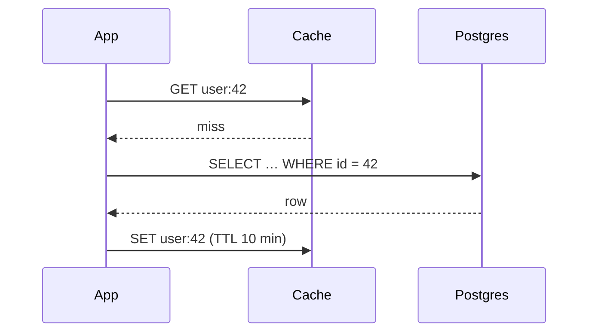
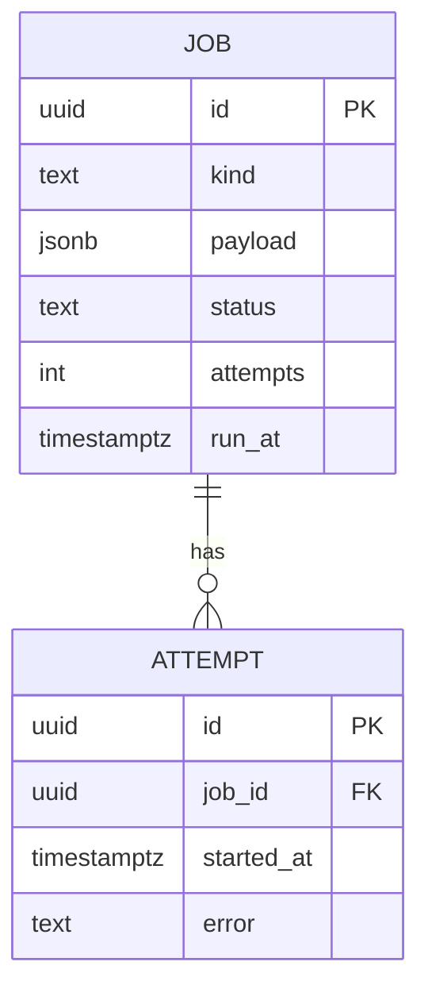

# Writing notes in Kaaga

Kaaga is the user's learning app; they revise what they write there. You write into it with the `kaaga` MCP tools. A note is Markdown with diagram fences, and **one `create_doc` call writes the whole note, diagrams included**. You never place boxes: you say what is in a diagram, and Kaaga lays it out.

## The workflow: two calls at most

1. `create_doc` with the full note (or `append_to_doc` / `replace_section` for an existing doc).
2. Read the answer. Every canvas reports its boxes, arrows, size, how big it shows in a doc, and any problems ("2 arrows cross", "box x has no arrows", "shows at 55%"). If a problem matters, fix it once with `update_canvas` (small changes) or `replace_section` with the corrected fence, then stop. `preview_diagram` shows you the board as a picture when you want to look.

**A small change to an existing doc** (one paragraph, a heading, a to-do ticked, a block removed): `get_outline` gives every block's id, then `update_block`, `insert_blocks` (after, before or under a block) or `delete_blocks` changes just that block, live, while they type elsewhere. Keep `replace_section` for rewriting a whole section.

Don't ask the user to arrange anything, and never write coordinates.

## Which diagram

| What you show | Use |
|---|---|
| Architecture, request or data flow, components and who calls whom, a concept map | a ```canvas board (the user can drag and edit it) |
| Calls in order over time (a request's path through services) | ```mermaid `sequenceDiagram` |
| Tables, keys and relations | ```mermaid `erDiagram` |
| States and transitions | ```mermaid `stateDiagram-v2` |
| Classes | ```mermaid `classDiagram` |
| A timeline / a mind map | ```mermaid `timeline` / `mindmap` |

## The canvas language

A Mermaid flowchart, a subset. Kaaga checks it and names the line of any mistake.

````
```canvas
flowchart
  user([User])@{ kind: user } -->|HTTPS| cdn[CDN]@{ kind: cdn } --> lb[Load balancer]@{ kind: lb }
  subgraph api [API tier]
    a1[API server 1]@{ kind: service }
    a2[API server 2]@{ kind: service }
  end
  lb --> a1 & a2
  a1 & a2 -->|read| cache[(Redis)]:::red@{ kind: cache }
  a1 & a2 -->|write| db[(Postgres primary)]:::blue@{ kind: database }
  db -.->|CDC| q[[Outbox queue]]:::yellow@{ kind: queue }
  note for db: Writes go to the primary; reads try the cache first.
```
````

- **Direction**: leave it out (`flowchart` alone) and Kaaga picks the one that reads bigger in a doc. Write `flowchart LR` only for a short chain (5 steps or fewer in a row); a long left-to-right board shrinks to unreadable in a doc column.
- **Boxes**: `id[box]`, `id(rounded)`, `id([pill])`, `id[(database)]`, `id((circle))`, `id{decision}`, `id[[queue]]`. Ids are letters, digits and `_`. Quote labels with brackets in them: `id["GET /items (cached)"]`; `<br>` breaks a line.
- **Arrows**: `-->`, `-.->` (dashed: async or occasional), `<-->` (both ways), `---` (no head); a label with `-->|label|`; chains `a --> b --> c`; `&` fans out: `a --> b & c`.
- **Zones**: `subgraph id [Title] … end`, nestable: "Client", "Edge", "API tier", "Data", a region or VPC.
- **Colour**: `:::blue`, `:::green`, `:::yellow`, `:::red`, `:::gray`. Use few, with a meaning: blue storage, green your services, gray external, yellow async, red a risk or bottleneck.
- **Kinds** give a box its icon and shape: `id@{ kind: database }`. Kinds: client, user, mobile, service, worker, function, database, cache, queue, stream, storage, search, cdn, dns, gateway, lb, auth, external, monitor, scheduler, notify, model.
- **Notes**: `note for id: text` (a sticky beside that box) or `note: text`.
- Not supported (Kaaga says so): `classDef`, `style`, `linkStyle`, `click`.

**Read it well**: 5–15 boxes per board, labels under 40 characters, every box on an arrow, one idea per board. Split a big system into two boards (the write path, the read path) rather than one crowded one.

**Changing a board**: `read_doc` prints each canvas in this language with `%% id: cv_…` on its first line. Send it back edited (keep that line) and every box the user moved stays where they put it; only new boxes are placed. For small changes use `update_canvas` with `add` (new lines), `remove` (box ids, or arrows as `a --> b`) and `rename`. Positions are kept, so a new direction or a cleaner layout needs `update_canvas` with `relayout: true` (that lays the whole board out again).

## What a good system-design note holds

1. **The point** in two or three sentences: the problem, and the one idea that solves it.
2. **Requirements**: functional and non-functional bullets, then a back-of-the-envelope estimate (requests per second, storage per year) with the arithmetic shown.
3. **The design**: a canvas of the main request path, then a few sentences walking through it.
4. **The data**: an `erDiagram` (or a short list of tables and keys) and why it is shaped that way.
5. **One flow in detail**: a `sequenceDiagram` of the hardest request.
6. **Trade-offs and failure cases**: what breaks first, what happens when a part dies, the alternatives and why not. Use a callout for the key insight: `> [!TIP]`, a trap: `> [!WARNING]`.
7. **Check yourself**: three to five questions as toggles, answer folded inside, so the user can test their recall:
   `<details><summary>Why is the counter range per server, not global?</summary>` answer `</details>`

Headings `##`, short paragraphs, lists; a small GFM table where a comparison reads best. One blank line between paragraphs.

## Worked example 1: a distributed cache

````markdown
## The point

A cache keeps hot data in memory in front of a slow store, so most reads never reach the database. The hard parts are keeping it fresh and surviving the cache's own failures.

## Requirements

- Reads under 5 ms at p99 for hot keys; the database stays the source of truth.
- 50k reads/s, 2k writes/s; 20 GB of hot data → 3 cache nodes of 16 GB with room to grow.

## The design

```canvas
flowchart
  app[App servers]@{ kind: service } -->|get key| ring{Hash ring}
  ring --> c1[(Cache node 1)]@{ kind: cache } & c2[(Cache node 2)]@{ kind: cache } & c3[(Cache node 3)]@{ kind: cache }
  app -.->|miss: read, then fill| db[(Postgres)]:::blue@{ kind: database }
  app -->|write| db
  db -.->|invalidate on change| bus[[Change stream]]:::yellow@{ kind: stream }
  bus -.-> c1 & c2 & c3
  note for ring: Consistent hashing: adding a node moves only about 1/n of the keys.
```

The app asks the ring which node owns a key. On a miss it reads the database and fills the cache (cache-aside). Writes go to the database; a change stream evicts the stale copies.

## One flow in detail



## Trade-offs and failure cases

> [!WARNING]
> A popular key expiring sends every request to the database at once (a stampede). Let one request refill it (a lock or request coalescing) and serve the stale value meanwhile.

- A node dies: its keys miss until refilled; the database must survive about a third more reads.
- TTL versus invalidation: TTL alone serves stale data for up to the TTL; invalidation is fresher but needs the change stream.

## Check yourself

<details><summary>Why consistent hashing instead of key mod n?</summary>

With mod n, adding a node remaps almost every key, so the whole cache misses at once. A hash ring moves only the keys of one arc.

</details>

<details><summary>What is a cache stampede and two ways to stop it?</summary>

Many requests miss the same expired key together and all hit the database. Stop it with a refill lock (one request refills) or by refreshing hot keys early.

</details>
````

## Worked example 2: a job queue with retries

````markdown
## The point

A queue takes slow work off the request path: the API answers at once, workers do the job later, and a failed job is retried instead of lost.

## The design

```canvas
flowchart
  api[API]@{ kind: service } -->|enqueue job| q[[Jobs]]:::yellow@{ kind: queue }
  subgraph workers [Worker pool]
    w1[Worker 1]@{ kind: worker }
    w2[Worker 2]@{ kind: worker }
  end
  q --> w1 & w2
  w1 & w2 -->|result| db[(Postgres)]:::blue@{ kind: database }
  w1 & w2 -.->|after 5 failures| dlq[[Dead letters]]:::red@{ kind: queue }
  sched[Scheduler]@{ kind: scheduler } -.->|retry with backoff| q
  note for dlq: A person looks at these; nothing is dropped silently.
```

## The data



## Trade-offs and failure cases

> [!TIP]
> Make every job idempotent (safe to run twice). Queues deliver at least once, so a worker that dies after the work but before the acknowledgement makes the job run again.

- Backoff (1 s, 4 s, 16 s…) keeps a sick dependency from being hammered.
- Ordering: one queue gives no global order; partition by key when order matters.

## Check yourself

<details><summary>Why does "at least once" delivery force idempotent jobs?</summary>

The acknowledgement can be lost after the work is done, so the job is delivered again. Running it twice must not double the effect.

</details>
````

<!-- installed by kaaga -->
